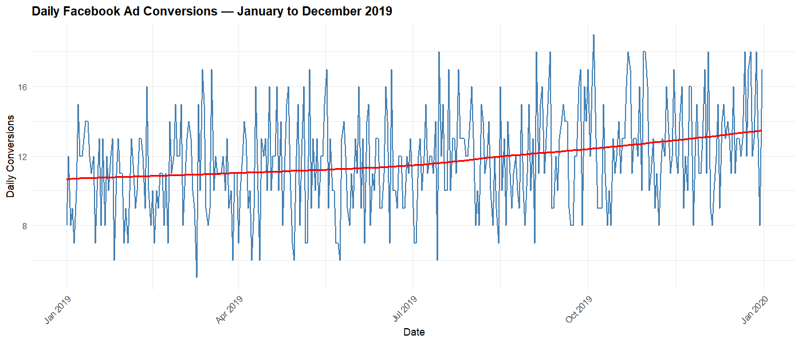
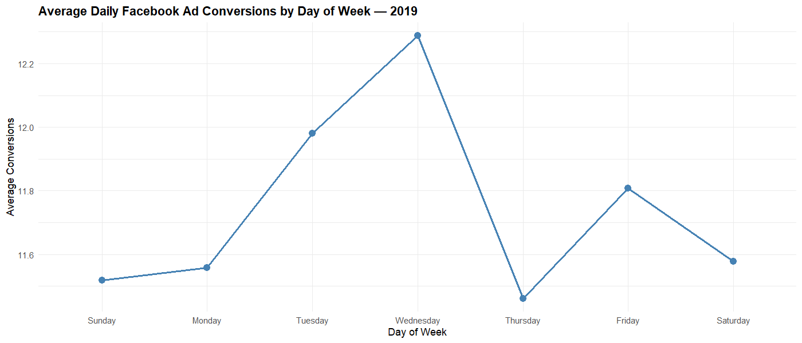
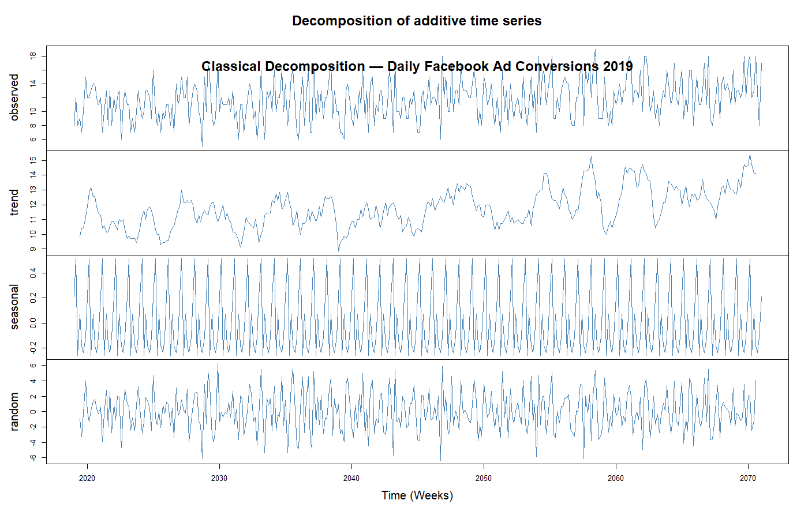
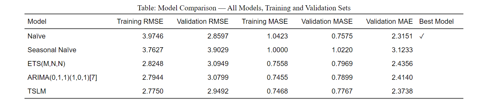
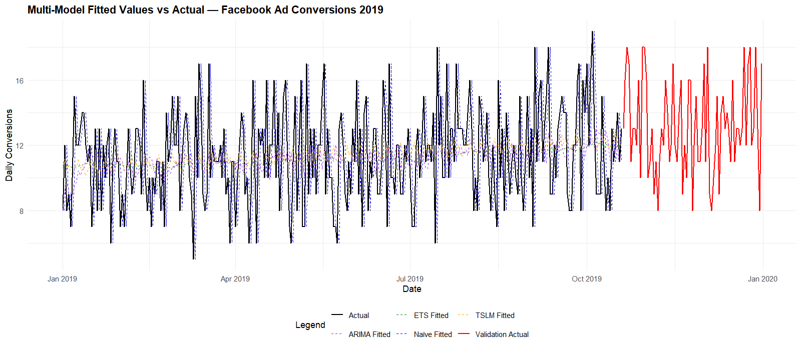
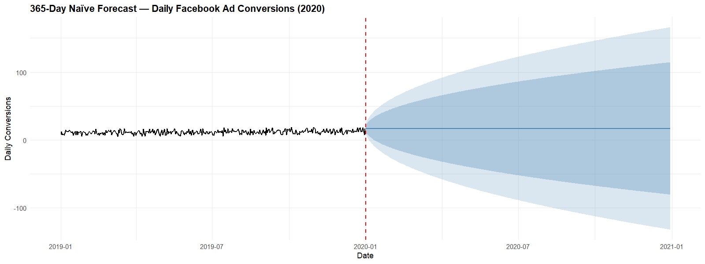

# Forecasting Daily Lead Conversions from Meta (Facebook) Advertising Campaigns in R

**Team project by:** Sharon Rosina Wamalwa and Simon Kanya

**Course:** DSCI 725, University of South Dakota (Spring 2026)

**Tools:** R (forecast, tseries, ggplot2)



---

## Business problem

Marketing teams running paid social campaigns make daily and weekly budget decisions without a clear view of how many leads to expect. Overestimating wastes ad spend; underestimating starves the sales pipeline. Most teams rely on historical averages and intuition.

This project builds and compares time-series models that forecast **daily Facebook ad conversions**, then produces a 365-day forecast for 2020. The goal is to support:

- daily and weekly budget pacing,
- pipeline and revenue forecasting, and
- less wasted ad spend in low-conversion periods.

**Stakeholders:** Marketing Director, Paid Media Manager, Revenue Operations, Executive Leadership.

## Data

- **Source:** [Advertising Efficiency Analysis: Facebook vs. AdWords (GitHub, Satakshi Deshmukh)](https://github.com/satakshideshmukh12/Advertising-Efficiency-Analysis-Facebook-vs.-AdWords-Campaigns/blob/main/marketing_campaign.csv)
- **Size:** 365 daily observations (January 1 – December 31, 2019), 17 variables, no missing values
- **Response variable:** daily Facebook ad conversions (leads per day)
- **Cleaning:** parsed dates, removed `$` and `%` signs from 8 cost and rate columns, converted them to numeric

| Metric | Mean | Min | Max |
|---|---|---|---|
| Daily conversions | 11.74 | 5 | 19 |
| Ad views | 2,180 | 1,050 | 3,320 |
| Clicks | 44 | 15 | 73 |
| Conversion rate | 27.15% | 21.48% | 47.59% |
| Cost per click | $2.19 | $0.61 | $7.14 |

## Methods

1. **Exploration:** time series plot with LOESS trend, day-of-week seasonal plot, classical additive decomposition, ACF and PACF.
2. **Stationarity and transformation:** Augmented Dickey-Fuller test (statistic –5.89, p = 0.01, stationary) and Box-Cox assessment (lambda = 0.68; no transformation applied).
3. **Feature engineering (for TSLM):** time index, day-of-week indicators, lag 1 and lag 7 conversions.
4. **Train/validation split (80/20):** training January 1 – October 19 (292 days); validation October 20 – December 31 (73 days).
5. **Models:** Naïve, Seasonal Naïve, ETS (auto-selected ETS(M,N,N)), ARIMA (auto-selected ARIMA(0,1,1)(1,0,1)[7]), and a Time Series Linear Model (trend + weekly seasonality).
6. **Evaluation:** RMSE, MAE, MAPE and MASE on the validation set, plus residual diagnostics and a Ljung-Box test.

## Key findings from exploration

| Day-of-week averages | Decomposition |
|---|---|
|  |  |

- **Mild upward trend:** from about 10–11 conversions a day in January to about 13 by December.
- **Weak weekly pattern:** Wednesday is the best day (12.29 average) and Thursday the weakest (11.46), a gap of under 1 conversion.
- **Noise dominates:** the remainder component ranges 12.59 conversions, compared with 0.77 for the seasonal component.

## Results



| Model | Validation RMSE | Validation MAE | Validation MASE |
|---|---|---|---|
| **Naïve (best)** | **2.86** | **2.32** | **0.758** |
| TSLM | 2.95 | 2.37 | 0.777 |
| ARIMA(0,1,1)(1,0,1)[7] | 3.08 | 2.41 | 0.790 |
| ETS(M,N,N) | 3.09 | 2.44 | 0.797 |
| Seasonal Naïve | 3.90 | 3.12 | 1.022 |

- **The simplest model won.** The naïve forecast (tomorrow = today) had the lowest validation error. The top four models were within 0.04 MASE of each other.
- **TSLM** came second and was the least biased (ME 0.68). Trend and day of week together explained only about 4% of the variation (R² = 0.041).
- **ARIMA** residuals passed the Ljung-Box test (p = 0.396), so no pattern was left unmodeled.
- **Seasonal naïve** was the only model worse than the benchmark, confirming the weekly pattern is too weak to rely on.
- All models had small training-to-validation gaps, so there was no sign of overfitting.



### 2020 forecast



The naïve model was refit on all 365 days to forecast every day of 2020. It projects **17 conversions per day** (the last observed value), with prediction intervals that widen quickly over the year.

## Business takeaways

- Day-to-day conversions are mostly driven by things the history does not contain: budget changes, targeting, ad creative and platform algorithm changes.
- Managers will get more from optimizing those levers (creative testing, targeting, pacing) than from relying on past conversion patterns alone.
- Short-range forecasts (days to a few weeks) are useful for pacing. Long-range point forecasts should be treated as a rough baseline only.

## Limitations

- **The 2020 forecast of 17 per day is optimistic.** It repeats the value from December 31, 2019, which was well above the 2019 average of 11.74 and the trend level of about 13 at year end. For budget planning, the TSLM or ETS level (about 12–13 per day) is a more conservative baseline.
- **Univariate models only.** Ad spend, impressions, clicks and CTR were not used as predictors.
- **One year of data** limits how well trend and seasonality can be estimated.
- **COVID-19** disrupted digital advertising in 2020 in ways no 2019 model could anticipate.
- **MASE baseline:** MASE in R's `accuracy()` is scaled by the in-sample seasonal naïve error, so values below 1 mean "better than a weekly seasonal naïve forecast".

## Next steps

- Add campaign inputs (spend, impressions, CTR, cost per click) as predictors (regression with ARIMA errors or dynamic regression).
- Try machine learning models such as gradient boosting.
- Use rolling-origin cross-validation instead of a single split.

## Repository structure

```
├── README.md
├── FacebookAdForecastingReport.docx   (full written report)

├── Work_Plan.xlsx                     (6-week work plan with estimated and actual hours)
└── images/                            (charts used in this README)
```

## Team

| Name | LinkedIn |
|---|---|
| Sharon Rosina Wamalwa | [linkedin.com/in/rosina-sharon](https://www.linkedin.com/in/rosina-sharon) |
| Simon Kanya | [linkedin.com/in/simonkanyamediabuyer](https://www.linkedin.com/in/simonkanyamediabuyer/) |

## Contact

- GitHub: [github.com/ROSINA365](https://github.com/ROSINA365)
- Email: rosinasharon6@gmail.com
